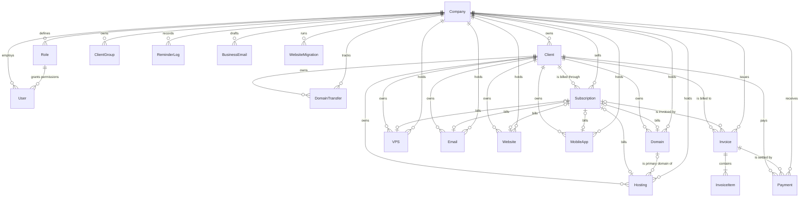

# Entity Relationship Diagram and Data Dictionary

> The data model of record. It mirrors [`../prisma/schema.prisma`](../prisma/schema.prisma)
> exactly; when they disagree, the schema is correct and this document is a bug.
> Any schema change must update this file in the same task.

**Last verified against the schema:** 2026-11-25 (19 models, 4 migrations).
**Related:** [`constitution.md`](constitution.md) (Article D1-D8),
[`architecture/modules.md`](architecture/modules.md).

---

## 1. Conventions

- Every id is a `cuid()` string.
- Every business table carries `companyId` with `onDelete: Cascade` from
  `Company`.
- Status and enum-like columns are `String`; the allowed values are documented
  in the schema header and repeated in each table below.
- Free text uses `@db.Text` (64 KB) or `@db.LongText` (4 GB).
- Money is stored as `Float` today (known debt, see the Risk Register in
  [`workflow.md`](workflow.md)); all arithmetic is rounded in `lib/billing/`.
- `createdAt`/`updatedAt` exist on every mutable model and are omitted from the
  tables below unless they are the only non-business fields.

---

## 2. Diagram

`ReminderLog` and `BusinessEmail` reference a client by plain `clientId` only;
there is no foreign key in the schema, so the diagram does not draw that edge.
The same applies to `MobileApp.domainId`, `hostingId`, `vpsId` and `emailIds`,
and to `Subscription.serviceId`.

---

## 3. Models

### 3.1 Company

Tenant root. One row per reseller company.

| Field | Type | Key / default | Notes |
| ----- | ---- | ------------- | ----- |
| id | String | PK | cuid |
| name | String | required | display name |
| ownerName | String? | | |
| email | String? | | company contact, not a login |
| phone | String? | | |
| address | String? | TEXT | |
| vatNumber | String? | | |
| logo | String? | LONGTEXT | sidebar/login asset |
| invoiceLogo | String? | LONGTEXT | invoice header asset |
| invoiceEmailHeaderHtml | String? | TEXT | template fragment |
| invoiceEmailBodyHtml | String? | LONGTEXT | template fragment |
| invoiceEmailFooterHtml | String? | TEXT | template fragment |
| reminderEmailHeaderHtml | String? | TEXT | template fragment |
| reminderEmailBodyHtml | String? | LONGTEXT | template fragment |
| reminderEmailFooterHtml | String? | TEXT | template fragment |
| dipencilLogo | String? | LONGTEXT | internal invoice branding |
| dipencilSellerName | String? | TEXT | internal invoice seller |
| dipencilSellerLines | String? | TEXT | internal invoice address |
| dipencilFooterLeft | String? | TEXT | internal invoice footer |
| dipencilFooterRight | String? | TEXT | internal invoice footer |
| clientInvoiceFooterLeft | String? | TEXT | client invoice footer |
| clientInvoiceFooterRight | String? | TEXT | client invoice footer |
| projectName | String? | default `diPencil Panel` | app title |
| favicon | String? | LONGTEXT | data URL |
| loginLogo | String? | LONGTEXT | login artwork |
| smtpHost | String? | | outgoing mail |
| smtpPort | Int? | default 465 | |
| smtpEncryption | String? | default `SSL` | `SSL` \| `TLS` \| `None` |
| smtpUser | String? | | |
| smtpPass | String? | TEXT | secret, never return |
| smtpFromName | String? | | |
| smtpFromEmail | String? | | |
| smtpTimeout | Int? | default 30 | seconds |
| smtpAuthEnabled | Boolean? | default true | |
| imapProtocol | String? | default `IMAP` | `IMAP` \| `POP3` |
| imapHost | String? | | incoming mail |
| imapPort | Int? | default 993 | |
| imapEncryption | String? | default `SSL` | |
| imapUser | String? | | |
| imapPass | String? | TEXT | secret, never return |
| imapMailbox | String? | default `INBOX` | |
| currency | String | default `USD` | ISO code |
| taxRate | Float | default 0 | percent |
| exchangeRates | String? | TEXT | JSON map |
| status | String | default `active` | `active` \| `suspended` |

### 3.2 Role

| Field | Type | Key / constraint | Notes |
| ----- | ---- | ---------------- | ----- |
| id | String | PK | |
| name | String | required | |
| description | String? | TEXT | |
| permissions | String | TEXT, required | JSON permission tree |
| companyId | String | FK -> Company, cascade | indexed |

### 3.3 User

| Field | Type | Key / constraint | Notes |
| ----- | ---- | ---------------- | ----- |
| id | String | PK | |
| username | String | **unique** | login name |
| name | String | required | display name |
| email | String | **unique** | global uniqueness |
| password | String? | | bcrypt hash, never serialise |
| avatar | String? | LONGTEXT | |
| status | String | default `active` | `active` \| `disabled` |
| lastLogin | DateTime? | | |
| lastLogoutAt | DateTime? | | |
| lastNotificationCheck | DateTime? | | |
| lastNotificationClearCheck | DateTime? | | |
| companyId | String | FK -> Company, cascade | indexed |
| roleId | String | FK -> Role, **restrict** | cannot delete a used role |

### 3.4 Client

| Field | Type | Key / constraint | Notes |
| ----- | ---- | ---------------- | ----- |
| id | String | PK | |
| name | String | required | |
| email | String | required | not unique |
| phone | String? | | |
| address | String? | TEXT | |
| companyName | String? | TEXT | |
| isDipencilInternal | Boolean | default false | hidden system client for internal invoices |
| companyId | String | FK -> Company, cascade | indexed |

### 3.5 ClientGroup

| Field | Type | Key / constraint | Notes |
| ----- | ---- | ---------------- | ----- |
| id | String | PK | |
| name | String | required | |
| description | String? | TEXT | |
| color | String? | | display hint |
| clientIds | String | TEXT, required | JSON array of client ids, no FK |
| companyId | String | FK -> Company, cascade | indexed |

### 3.6 Domain

| Field | Type | Key / constraint | Notes |
| ----- | ---- | ---------------- | ----- |
| id | String | PK | |
| name | String | required | |
| tld | String | required | |
| registrar | String | required | |
| expiryDate | DateTime | required | renewal anchor |
| autoRenew | Boolean | default true | |
| status | String | default `active` | `active` \| `expiring` \| `expired` \| `suspended` |
| nameservers | String? | TEXT | JSON array |
| notes | String? | TEXT | |
| reminderDays | Int? | | per-domain override |
| price | Float | default 0 | |
| currency | String | default `USD` | |
| billingCycle | String | default `yearly` | `monthly` \| `yearly` |
| clientId | String | FK -> Client, cascade | indexed |
| companyId | String | FK -> Company, cascade | indexed |
| subscriptionId | String? | FK -> Subscription, **unique**, set null | one-to-one |

Indexes: `clientId`, `companyId`, `status`.

### 3.7 DomainTransfer

| Field | Type | Key / constraint | Notes |
| ----- | ---- | ---------------- | ----- |
| id | String | PK | |
| domainName | String | required | |
| tld | String | required | |
| previousProvider | String | required | |
| transferDate | DateTime | required | |
| expiryDate | DateTime? | | |
| status | String | default `pending` | `pending` \| `completed` \| `failed` |
| autoRenew | Boolean | default true | |
| notes | String? | TEXT | |
| price | Float | default 0 | no currency column, uses company currency |
| clientId | String | FK -> Client, cascade | indexed |
| companyId | String | FK -> Company, cascade | indexed |

### 3.8 Hosting

| Field | Type | Key / constraint | Notes |
| ----- | ---- | ---------------- | ----- |
| id | String | PK | |
| name | String | required | |
| type | String | required | `web` \| `wordpress` \| `cloud` \| `node` |
| planName | String | required | |
| status | String | default `active` | `active` \| `suspended` \| `expired` |
| expiryDate | DateTime? | | |
| resources | String? | TEXT | JSON `{cpu, ram, storage, bandwidth}` |
| price | Float | default 0 | |
| currency | String | default `USD` | |
| billingCycle | String | default `monthly` | |
| clientId | String | FK -> Client, cascade | indexed |
| companyId | String | FK -> Company, cascade | indexed |
| subscriptionId | String? | FK -> Subscription, **unique**, set null | one-to-one |
| domainId | String? | FK -> Domain, set null | primary domain, indexed |
| panelUrl | String? | | external control panel |

### 3.9 VPS

| Field | Type | Key / constraint | Notes |
| ----- | ---- | ---------------- | ----- |
| id | String | PK | |
| name | String | required | |
| planName | String | required | |
| ram | Int | required | MB |
| storage | Int | required | GB |
| cpu | Int | required | cores |
| status | String | default `active` | free-form today |
| expiryDate | DateTime? | | |
| notes | String? | TEXT | |
| price | Float | default 0 | |
| currency | String | default `USD` | |
| billingCycle | String | default `monthly` | |
| clientId | String | FK -> Client, cascade | indexed |
| companyId | String | FK -> Company, cascade | indexed |
| subscriptionId | String? | FK -> Subscription, **unique**, set null | one-to-one |

### 3.10 Email

| Field | Type | Key / constraint | Notes |
| ----- | ---- | ---------------- | ----- |
| id | String | PK | |
| name | String | required | mailbox name |
| domain | String | required | mail domain, not a Domain FK |
| storage | Int | required | MB |
| status | String | default `active` | free-form today |
| expiryDate | DateTime? | | |
| price | Float | default 0 | |
| currency | String | default `USD` | |
| billingCycle | String | default `monthly` | |
| clientId | String | FK -> Client, cascade | indexed |
| companyId | String | FK -> Company, cascade | indexed |
| subscriptionId | String? | FK -> Subscription, **unique**, set null | one-to-one |

### 3.11 Website

| Field | Type | Key / constraint | Notes |
| ----- | ---- | ---------------- | ----- |
| id | String | PK | |
| name | String | required | |
| domain | String | required | plain string |
| type | String | default `wordpress` | `wordpress` \| `node` \| `php` \| `html` |
| storage | Int | default 0 | MB |
| bandwidth | Int | default 0 | MB |
| status | String | default `active` | `active` \| `inactive` \| `suspended` |
| linkedDomain | String? | | plain domain name |
| planName | String? | | |
| planPrice | Float | default 0 | |
| billingCycle | String | default `monthly` | |
| renewalDate | DateTime? | | |
| clientId | String | FK -> Client, cascade | indexed |
| companyId | String | FK -> Company, cascade | indexed |
| subscriptionId | String? | FK -> Subscription, **unique**, set null | one-to-one |

### 3.12 MobileApp

| Field | Type | Key / constraint | Notes |
| ----- | ---- | ---------------- | ----- |
| id | String | PK | |
| name | String | required | |
| appType | String | required | `android` \| `ios` \| `windows` |
| framework | String | default `native` | framework list in schema |
| description | String? | TEXT | |
| status | String | default `development` | `development` \| `live` \| `suspended` \| `expired` |
| plan | String | default `basic` | `basic` \| `pro` \| `enterprise` |
| price | Float | default 0 | |
| billingCycle | String | default `monthly` | |
| autoRenew | Boolean | default true | |
| expiryDate | DateTime? | | |
| domainId | String? | soft reference | no FK; validate in action |
| hostingId | String? | soft reference | no FK |
| vpsId | String? | soft reference | no FK |
| emailIds | String | TEXT, required | JSON array, no FK |
| clientId | String | FK -> Client, cascade | indexed |
| companyId | String | FK -> Company, cascade | indexed |
| subscriptionId | String? | FK -> Subscription, **unique**, set null | one-to-one |

### 3.13 Subscription

Billing anchor for one service. Polymorphic through `serviceType` + `serviceId`.

| Field | Type | Key / constraint | Notes |
| ----- | ---- | ---------------- | ----- |
| id | String | PK | |
| serviceType | String | required | `domain` \| `hosting` \| `vps` \| `email` \| `website` \| `mobile_app` |
| serviceId | String | required | soft reference to the service row |
| serviceName | String? | | denormalised label |
| planName | String? | | |
| price | Float | required | client-facing |
| providerPrice | Float? | | internal cost, never on invoices |
| currency | String | default `USD` | |
| billingCycle | String | required | `monthly` \| `yearly` |
| startDate | DateTime | required | |
| endDate | DateTime | required | indexed |
| autoRenew | Boolean | default true | |
| status | String | default `active` | `active` \| `cancelled` \| `expired` \| `suspended` |
| notes | String? | TEXT | |
| domainId | String? | | optional manual link, no FK |
| clientId | String | FK -> Client, cascade | indexed |
| companyId | String | FK -> Company, cascade | indexed |

Reverse one-to-one: `Domain`, `Hosting`, `VPS`, `Email`, `Website`, `MobileApp`.

### 3.14 Invoice

| Field | Type | Key / constraint | Notes |
| ----- | ---- | ---------------- | ----- |
| id | String | PK | |
| number | String | required, **not unique in the database** | generated per company in `lib/billing` |
| issueDate | DateTime | required | |
| dueDate | DateTime | required | |
| nextBillingDate | DateTime? | | |
| status | String | default `pending` | `paid` \| `pending` \| `overdue` |
| paymentStatus | String | default `unpaid` | `paid` \| `unpaid` \| `partial` |
| currency | String | default `USD` | |
| notes | String? | TEXT | |
| subtotal | Float | required | |
| discountAmount | Float | default 0 | |
| vatAmount | Float | default 0 | |
| total | Float | required | `subtotal - discount + vat` |
| invoiceKind | String | default `client` | `client` \| `dipencil` |
| counterpartyName | String? | TEXT | internal invoices |
| counterpartyAddress | String? | TEXT | internal invoices |
| clientId | String | FK -> Client, **restrict** | indexed |
| companyId | String | FK -> Company, cascade | indexed |
| subscriptionId | String? | FK -> Subscription, set null | indexed through relation |

### 3.15 InvoiceItem

| Field | Type | Key / constraint | Notes |
| ----- | ---- | ---------------- | ----- |
| id | String | PK | |
| description | String | TEXT, required | |
| quantity | Int | default 1 | |
| price | Float | required | unit price |
| discount | Float | default 0 | |
| vat | Float | default 0 | |
| invoiceId | String | FK -> Invoice, cascade | no `companyId` |

`InvoiceItem` is tenant-scoped through its invoice. Any query that reads items
directly must join or verify the parent invoice's `companyId`.

### 3.16 Payment

| Field | Type | Key / constraint | Notes |
| ----- | ---- | ---------------- | ----- |
| id | String | PK | |
| amount | Float | required | must not exceed the invoice total |
| method | String | required | `card` \| `bank_transfer` \| `paypal` \| `cash` |
| currency | String | default `USD` | should match the invoice |
| date | DateTime | default now | |
| notes | String? | TEXT | |
| status | String | default `completed` | `completed` \| `failed` \| `refunded` |
| invoiceId | String | FK -> Invoice, cascade | indexed |
| clientId | String | FK -> Client, **restrict** | indexed |
| companyId | String | FK -> Company, cascade | indexed |

`Payment.clientId` must equal the invoice's `clientId`; the database does not
enforce it, the Server Action must.

### 3.17 ReminderLog

| Field | Type | Key / constraint | Notes |
| ----- | ---- | ---------------- | ----- |
| id | String | PK | |
| companyId | String | FK -> Company, cascade | indexed |
| clientId | String | plain string | no FK |
| serviceType | String | required | same set as Subscription |
| serviceId | String | required | indexed, no FK |
| serviceName | String | required | snapshot |
| daysLeft | Int | required | at send time |
| sentAt | DateTime | default now | |

Deduplication is by `companyId` + `serviceId` + `daysLeft` at the application
level. There is no unique constraint today.

### 3.18 BusinessEmail

| Field | Type | Key / constraint | Notes |
| ----- | ---- | ---------------- | ----- |
| id | String | PK | |
| companyId | String | FK -> Company, cascade | indexed |
| clientId | String? | plain string | indexed, no FK |
| type | String | required | `quotation` \| `contract` \| `project_start` \| `custom` |
| subject | String | TEXT, required | |
| body | String | LONGTEXT, required | no database default |
| status | String | default `draft` | `draft` \| `sent` |
| sentAt | DateTime? | | |

### 3.19 WebsiteMigration

| Field | Type | Key / constraint | Notes |
| ----- | ---- | ---------------- | ----- |
| id | String | PK | |
| sourceIp | String | required | SSRF-sensitive |
| port | Int | default 22 | |
| username | String | required | |
| password | String | TEXT, required | AES-256-CBC encrypted |
| type | String | default `cpanel` | |
| status | String | default `pending` | `pending` \| `analyzing` \| `ready` \| `in_progress` \| `completed` \| `failed` \| `cancelled` |
| logs | String | LONGTEXT, required | JSON array of `{time,message,level}` |
| dataSize | Float | default 0 | MB |
| notes | String? | TEXT | |
| errorMessage | String? | TEXT | |
| companyId | String | FK -> Company, cascade | indexed |

---

## 4. Constraint inventory

### 4.1 Enforced by the database

| Constraint | Where |
| ---------- | ----- |
| Primary keys | all 19 models |
| Unique login fields | `User.username`, `User.email` |
| One subscription per service | `Domain.subscriptionId`, `Hosting.subscriptionId`, `VPS.subscriptionId`, `Email.subscriptionId`, `Website.subscriptionId`, `MobileApp.subscriptionId` (all unique) |
| Tenant cascade | every `companyId` relation |
| Financial restrict | `Invoice.clientId`, `Payment.clientId`, `User.roleId` |
| Owned child cascade | `InvoiceItem.invoiceId`, `Payment.invoiceId`, service -> client |
| Optional link set-null | six service `subscriptionId` columns, `Hosting.domainId` |

### 4.2 Enforced only in application code

| Rule | Consequence if broken |
| ---- | --------------------- |
| Invoice number unique per company | duplicate invoice numbers, broken reconciliation |
| `total = subtotal - discount + vat` | wrong money on issued invoices |
| Sum of payments <= total | overpayment, wrong `paymentStatus` |
| `Payment.clientId` = invoice client | payment attributed to the wrong client |
| `Invoice.companyId` = client company | cross-tenant invoice |
| Reminder deduplication | duplicate reminder emails |
| Soft-reference ownership | linked record from another tenant |
| `WebsiteMigration.password` encryption | credential leak |

### 4.3 Known schema gaps

1. `Invoice.number` has no `@@unique([companyId, number])`. Concurrent creates
   can collide. Fix with a migration plus a retry loop on conflict.
2. `ReminderLog.clientId`, `ReminderLog.serviceId`, `BusinessEmail.clientId` and
   `Subscription.serviceId` have no foreign keys. Deleted records leave
   dangling references that the read paths must tolerate.
3. `InvoiceItem` has no `companyId`; tenant safety depends on the parent.
4. `ClientGroup.clientIds` and `MobileApp.emailIds` are JSON strings inside
   `TEXT`; they cannot be indexed or joined.
5. Money is `Float`, not `DECIMAL`. Rounding is enforced in code only.
6. `DomainTransfer` has no currency column; it inherits the company currency.

These gaps are tracked in the Risk Register in [`workflow.md`](workflow.md).

---

## 5. Change procedure

1. Edit [`../prisma/schema.prisma`](../prisma/schema.prisma).
2. Run `pnpm db:migrate --name <intent>` to create the migration.
3. Run `pnpm db:generate`.
4. Update this document (model table, diagram, constraints) in the same change.
5. Run `pnpm db:smoke` and exercise the affected query.
6. Never use `db push` for a change destined for `main`.
7. Never run `db reset` without explicit owner approval.
